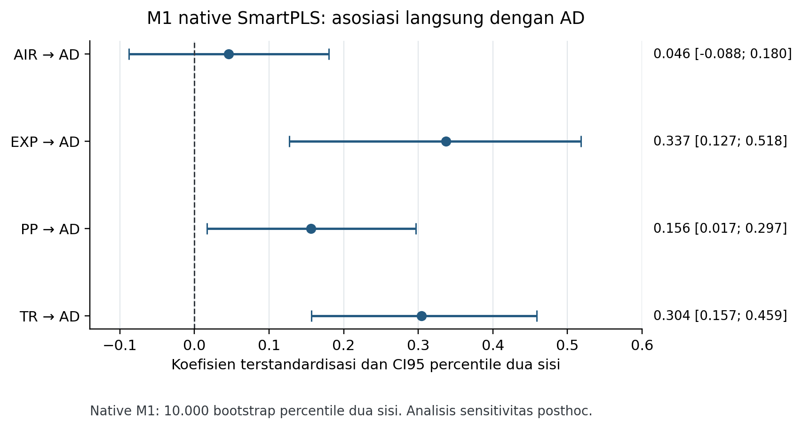

# KidSense: klarifikasi konstruk dan analisis sensitivitas model

**Status: draf teknis untuk ditinjau.** Definisi dan item kini diselaraskan dengan keterangan peneliti. Model awal M0 tetap hasil utama yang telah diverifikasi native. M1 tetap analisis tambahan eksploratori. Estimasi titik serta bootstrap tujuh jalurnya telah diverifikasi native dari KidSense_M1_DenganTR_Bootstrap_10000.xlsx. Tabel dan gambar utama M1 berikut memakai hasil native; pembanding Python disimpan terpisah.

## Keputusan setelah membaca instrumen

EXP, PP, dan AD memiliki isi yang berbeda secara konseptual: pemahaman penjelasan, persepsi perlindungan privasi, dan niat adopsi. Tidak ada dasar isi yang cukup untuk menghapus item tertentu atau menggabungkan konstruk hanya karena batas atas HTMT EXP–PP dan EXP–AD belum memenuhi 0,90. Perbedaan konseptual ini juga tidak menghapus keterbatasan diskriminan pada data yang tersedia.

Label asli **Explainability** dipertahankan, dengan penjelasan bahwa operasionalisasinya adalah pemahaman yang dilaporkan orang tua terhadap penjelasan. Ini bukan pengukuran objektif kemampuan XAI. AIR adalah perceived AI reliability, dan PP adalah perceived privacy protection; angka skala tidak membuktikan akurasi pengenalan emosi, keamanan aktual, atau audit privasi.

AD harus disebut **niat adopsi hipotetis dan kondisional**. Responden diminta membayangkan KidSense tersedia, memenuhi persyaratan keamanan, dan berfungsi sesuai rancangan. AD4 menambahkan kondisi pengalaman masa depan memenuhi harapan. Jadi hasil AD tidak diinterpretasikan sebagai perilaku penggunaan aktual, retensi yang sudah diamati, atau permintaan pasar tanpa syarat.

## Definisi operasional peneliti

Definisi berikut berasal dari cakupan indikator yang diberikan peneliti, bukan kutipan teori dari publikasi eksternal.

**AIR — Perceived AI Reliability.** Persepsi orang tua mengenai kemampuan KidSense menghasilkan deteksi emosi dan notifikasi yang konsisten, sesuai dengan kondisi anak, serta beroperasi secara stabil selama aktivitas bermain digital.

**EXP — Explainability.** Tingkat pemahaman orang tua terhadap alasan, informasi pendukung, tingkat keyakinan prediksi, dan kemungkinan kesalahan yang dijelaskan oleh KidSense.

**PP — Perceived Privacy Protection.** Persepsi orang tua mengenai kecukupan mekanisme perlindungan data anak, termasuk persetujuan akses kamera dan mikrofon, penyimpanan data, serta penghapusan data dalam rancangan KidSense.

**TR — Trust.** Tingkat kepercayaan orang tua terhadap KidSense sebagai sistem yang dirancang untuk kepentingan anak dan mampu memberikan informasi awal mengenai kondisi emosi secara bertanggung jawab.

**AD — Adoption Intention.** Niat orang tua untuk mencoba, menggunakan, memanfaatkan fitur peringatan dini, dan berpotensi menggunakan KidSense secara berkelanjutan apabila sistem tersedia dan memenuhi harapan.

## Tinjauan isi indikator

- **EXP1 dan EXP2:** alasan kategori emosi dan dasar peringatan adalah konteks informasi yang berdekatan, tetapi tidak identik secara otomatis. EXP4 menilai bantuan penjelasan untuk menafsirkan peringatan. Tidak ada isi privasi atau niat penggunaan yang dinyatakan langsung dalam item-item itu.
- **EXP3:** pemahaman tingkat keyakinan dan kemungkinan kesalahan AI tercakup dalam satu pernyataan. Pemeriksaan kognitif dapat menilai apakah kedua bagian dipahami konsisten; ini belum menjadi bukti bahwa item tersebut salah atau harus dihapus.
- **PP:** PP1/PP4 lebih global, sedangkan PP2/PP3 mencakup consent serta penyimpanan/penghapusan. Spesifikasi reflektif perlu dijelaskan sebagai manifestasi persepsi perlindungan umum. Keragaman aspek tidak cukup untuk menyimpulkan PP harus formatif atau mengganti model pengukuran pada data lama.
- **AD:** mencoba, rencana menggunakan, pemanfaatan peringatan, dan keberlanjutan bersyarat mencakup beberapa tahap niat. Definisi yang luas dapat mengakomodasi cakupan tersebut, tetapi naskah tidak boleh menyebutnya hanya initial adoption atau actual continuance tanpa pembatasan.
- **Prompt AD:** asumsi keamanan/fungsi harus ditulis dalam metode dan batas generalisasi. Prompt dapat membentuk konteks jawaban, tetapi tanpa kelompok pembanding, arah atau ukuran pengaruhnya tidak dapat ditentukan.
- **AIR dan TR:** nama serta definisinya tersedia; teks empat item masing-masing belum diberikan, sehingga tinjauan isi kedua skala belum menyeluruh.

## Draf metode dan hasil utama M0

Analisis melibatkan 271 observasi dan 20 indikator untuk AIR (Perceived AI Reliability), EXP (Explainability), PP (Perceived Privacy Protection), TR (Trust), dan AD (Adoption Intention). Responden menilai deskripsi dan gambar rancangan KidSense. Jawaban merefleksikan persepsi atas konsep yang disajikan dan niat penggunaan hipotetis, bukan evaluasi penggunaan prototipe fungsional. Dalam bagian AD, responden diminta membayangkan bahwa KidSense tersedia, memenuhi persyaratan keamanan, dan berfungsi sesuai rancangan. Asumsi dalam skenario tersebut tidak diperlakukan sebagai bukti keamanan atau kinerja aktual.

Estimasi native SmartPLS 4.1.2.1 memakai path weighting dan hasil terstandardisasi. Pengukuran reflektif disimpan dengan outer weighting AUTOMATIC; perhitungan independen Mode A mereproduksi estimasi titik. Bootstrap utama memakai 10.000 subsamples, two-tailed α0,05 dan percentile CI 95%. HTMT dinilai terpisah dengan BCa satu sisi 95% terhadap ambang 0,90. Prediksi memakai Direct antecedents,10 folds × 10 repetitions dan Fixed seed; angka seed native tidak tercatat.

Dalam M0, AIR→TR β 0,260379 CI95 [0,139482;0,380324], EXP→TR β 0,293921[0,157908;0,425392], PP→TR β 0,315452[0,164208;0,465164], dan TR→AD β 0,687964[0,603460;0,764247]. Keempat p native <0,001. R² TR 0,616399 dan AD 0,473295. Semua tiga asosiasi tidak langsung melalui TR memiliki interval yang tidak memuat nol.

Hasil itu tidak menguji mediasi penuh/parsial: jalur langsung AIR/EXP/PP→AD tidak diestimasi pada model awal. Tidak adanya jalur dalam diagram bukan direct effects yang terbukti tidak signifikan. Asosiasi tersebut tidak menetapkan sebab-akibat.

Batas atas BCa 95% HTMT EXP–PP 0,908139 dan EXP–AD 0,912789 belum memenuhi <0,90. Kriteria fit estimated composite model d_ULS dan d_G juga melewati batas bootstrap. Prediksi native memberi 8 Q²_predict positif; RMSE PLS lebih rendah dari LM pada 5/8 indikator dan MAE pada 7/8. CVPAT Overall signifikan terhadap benchmark mean (IA), tetapi belum terhadap LM (p = 0,122338). Prediksi AD menggunakan TR yang diamati dan bersifat kondisional.

## Analisis tambahan M1 — native terverifikasi, tetap eksploratori

M1 mempertahankan seluruh 271 responden dan 20 indikator. Ketiga jalur langsung AIR→AD,EXP→AD,PP→AD ditambahkan bersama ke model awal untuk memeriksa sensitivitas pembatasan bahwa semua asosiasi dengan AD melalui TR. Jalur tidak dipilih satu per satu berdasarkan p. Ini analisis posthoc setelah hasil awal diketahui, bukan hipotesis konfirmatori baru.

M1 native memakai10.000bootstrap,Complete,Percentile,Two-tailed,alpha0,05,Fixed seed danSmartPLS 4.1.2.1. Nilai seed numerik tidak diekspor. Sebanyak32estimasi titik identik dengan algoritma nativeM1 dan cocok denganPython hingga1,00411×10⁻¹⁰. Pembanding Python menggunakan empat stream NumPydefault_rng20261106–20261109; interval antarRNG tidak diharapkan identik. Seluruh keputusan CI utama sama.

| Jalur ke AD | β native M1 | p native | CI95 percentile native | Memuat nol? |
|---|---:|---:|---|---|
| AIR -> AD | 0.045605 | 0.505143 | [-0.087686; 0.180170] | Ya |
| EXP -> AD | 0.337191 | 0.000771185 | [0.127204; 0.517708] | Tidak |
| PP -> AD | 0.156463 | 0.027921 | [0.017163; 0.296779] | Tidak |
| TR -> AD | 0.304012 | 6.96902e-05 | [0.156881; 0.459000] | Tidak |

Gambar. Koefisien dan CI95 percentile untuk empat prediktor AD pada M1. Interval berasal dari bootstrap native yang sudah diperbaiki. M1 tetap analisis sensitivitas posthoc.

Pada M1, EXP dan PP memiliki asosiasi langsung positif dengan AD serta CI yang tidak memuat nol; AIR direct masih memuat nol. TR→AD tetap positif. Ketiga asosiasi tidak langsung melalui TR juga memiliki CI yang tidak memuat nol: AIR 0,079954[0,032983;0,143367], EXP 0,089052[0,035225;0,158803], dan PP 0,095297[0,037491;0,168760]. Ini pola asosiasi langsung/tidak langsung dalam model tambahan, bukan bukti mediasi kausal atau pembuktian efek AIR tepat nol.

R² AD M1=0,575904, dibanding 0,473295 pada M0; R² TR M1=0,615656. Angka ini bersifat deskriptif karena jumlah parameter bertambah dan bobot komposit berubah. **Bagian kovarians struktural skor M1 tersaturasi: 15 parameter untuk 15 momen unik**. Hal itu tidak menyaturasi seluruh model indikator, tetapi berarti peningkatan fit kovarians skor tidak dapat dipakai mengonfirmasi teori yang ditambahkan.

Pada fit nativeM1, estimated dan saturated sama secara numerik. Composite estimated mempunyaiSRMR0,031026,d_ULS0,202144,d_G0,145440 di bawahHI95 masing-masing0,034508;0,250075;0,164052. Namun mixed estimated masih melewatiHI95 padaSRMR(0,049034>0,044696),d_ULS(0,504913>0,419530),dan d_G(0,275551>0,274682). Karena itu, perbaikan fitcomposite tidak diperlakukan sebagai bukti semua diagnostikfit lolos atau teori jalur baru terkonfirmasi.

AIRlangsung memiliki p0,505143 dan CI yang memuatnol. TotalasosiasiAIR memiliki p0,047521 danCIpercentile[0,002081;0,253714], tetapi correctedCI[−0,002360;0,249998] memuatnol. Total dan direct effects dibedakan; bila totalAIR dibahas, sensitivitas metodeinterval perlu dilaporkan.

Penambahan jalur tidak mengubah estimasi titik HTMT EXP–PP/EXP–AD karena HTMT berbasis korelasi item, sedangkan data serta pengelompokan indikator tetap sama. Tabel HTMT pada runM1 ini dua sisi2,5%/97,5% dan identik denganM0. Untuk kriteria batasatasBCa95 satu sisi tetap gunakan run khusus sebelumnya. Estimasi titik danbootstrap M1 kini selesai diverifikasi; filebootstrap lama tanpaTR tetap diarsipkan sebagai model lain. Prediksi M1 belum diuji. Hasil ini mendukung pemeriksaan sensitivitas yang transparan, bukan penggantian otomatis model utama.

## Protokol verifikasi native M1 yang terpisah

1. Pertahankan model dan ekspor M0. Buat salinan bernama **KidSense_M1_Eksploratori** dengan dataset 271 dan 20 indikator yang sama.
2. Pertahankan empat jalur awal. Tambahkan AIR→AD, EXP→AD, dan PP→AD bersama-sama; jangan menghapus item atau kasus.
3. Jalankan PLS-SEM Path/Standardized dengan initial Default; simpan pengaturan dan ekspor M1 terpisah.
4. Jalankan bootstrap 10.000, Complete, Percentile, Two-tailed, α0,05, Fixed seed. Simpan sebagai **KidSense_M1_Bootstrap_10000.xlsx**.
5. Bandingkan direct serta specific indirect dan CI dengan tabel M1 Python. Beri label sensitivitas posthoc; perbedaan RNG tidak membuat CI wajib identik.
6. Penggunaan M1 sebagai klaim utama memerlukan alasan teori dan validasi lebih lanjut. Kenaikan R²/fit saja tidak cukup. Native PLSpredict/CVPAT M1 belum dijalankan. Perbandingan M0–M1 perlu informasi prediktor danfold yang setara: Direct antecedents M1 menambahkan informasiAD yang tidak dipakaiM0. Skenario Earlyantecedents pada kedua model dapat ditetapkan sebagai pembandingan tersendiri, dengan benchmark danfold yang dicatat.

## Draf pembahasan yang diperbarui

Temuan menunjukkan bahwa persepsi reliabilitas AI, pemahaman penjelasan, dan persepsi perlindungan privasi berasosiasi dengan trust pada rancangan KidSense. Trust berasosiasi dengan niat adopsi dalam skenario keamanan dan fungsi yang ditetapkan. Konsistensi komputasi lintas perhitungan mendukung ketepatan angka, tetapi tidak menghilangkan keterbatasan diskriminasi sebagian konstruk dan fit model.

Analisis tambahan mengindikasikan bahwa pembatasan semua asosiasi Explainability dan Perceived Privacy Protection terhadap Adoption Intention melalui Trust patut ditinjau secara substantif. Namun, M1 adalah analisis posthoc pada sampel yang sama dengan kovarians struktural skor tersaturasi. Hasilnya tidak digunakan sebagai konfirmasi teori baru atau alasan menghapus konstruk. Isi item, sumber teori, dan data independen perlu menopang keputusan revisi.

Niat adopsi yang tinggi pada skenario hipotetis tidak setara dengan perilaku menggunakan KidSense. Demikian pula skor AIR dan PP tidak membuktikan kinerja teknis sistem atau perlindungan data yang sudah diaudit. Kesimpulan dibatasi pada persepsi dan niat orang tua setelah menilai deskripsi/gambar rancangan. Hasil ini membahas penerimaan konsep pada skenario yang diberikan; generalisasi ke pengalaman penggunaan dan adopsi aktual memerlukan pengujian lebih lanjut. Materi stimulus persis, protokol survei lengkap dan bukti penyaringan 323 → 271 masih perlu dilengkapi.

## Item asli yang disediakan peneliti

**EXP1.** Saya memahami alasan KidSense menampilkan kategori emosi tertentu.

**EXP2.** Saya memahami informasi yang menjadi dasar munculnya peringatan KidSense.

**EXP3.** Saya memahami arti tingkat keyakinan dan kemungkinan kesalahan hasil prediksi AI yang ditampilkan.

**EXP4.** Penjelasan yang tersedia memudahkan saya menafsirkan informasi peringatan KidSense.

**PP1.** Menurut saya, mekanisme perlindungan privasi yang ditampilkan KidSense memberikan perlindungan terhadap data anak.

**PP2.** Saya menilai mekanisme persetujuan penggunaan kamera dan mikrofon dalam KidSense memperhatikan privasi anak.

**PP3.** Saya menilai mekanisme pengaturan penyimpanan dan penghapusan data dalam KidSense mendukung perlindungan privasi anak.

**PP4.** Secara keseluruhan, saya merasa perlindungan privasi yang dirancang dalam KidSense memadai untuk penggunaan oleh orang tua.

**AD1.** Saya berniat mencoba aplikasi KidSense.

**AD2.** Saya berencana menggunakan KidSense untuk membantu mendampingi aktivitas bermain digital anak.

**AD3.** Saya berniat memanfaatkan fitur peringatan dini KidSense ketika diperlukan.

**AD4.** Saya berminat menggunakan KidSense secara berkelanjutan apabila pengalaman penggunaannya sesuai harapan.

## Jejak sumber dan batas

Nama dan definisi konstruk serta 12 item merupakan informasi yang diberikan peneliti, bukan kutipan dari literatur eksternal. Angka M0 berasal dari ekspor native yang sudah diverifikasi. Angka M1 pada tabel/gambar utama berasal dari ekspor native yang sudah diperbaiki. Pembanding Python tetap tersedia dan diberi label terpisah. Penilaian isi bukan pengganti validasi ahli atau studi kognitif. Format jurnal dan sumber/adaptasi skala belum ditetapkan dalam dokumen ini. Semua data serta model awal dipertahankan.
