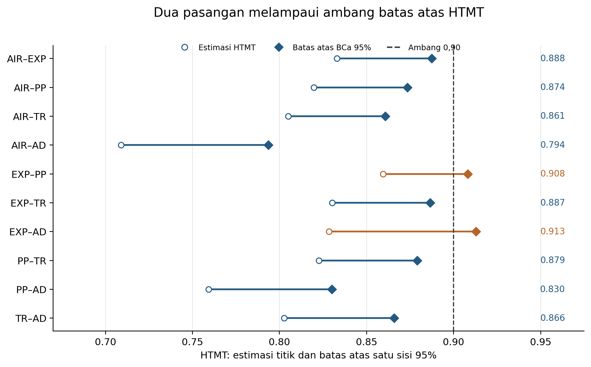
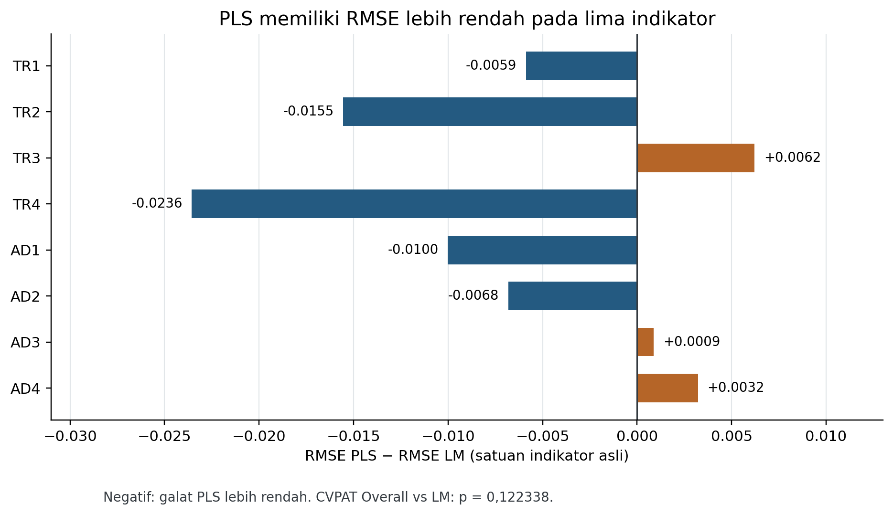

# Draf hasil dan peninjauan model KidSense

**Status: draf teknis untuk ditinjau.** Hasil numerik dapat dilaporkan, tetapi naskah belum dapat menyatakan bahwa seluruh konstruk terpisah secara diskriminan, seluruh fit memadai, atau PLS mengungguli regresi linear secara signifikan. Kepanjangan konstruk dan teks kuesioner belum tersedia; singkatan AIR, EXP, PP, TR, dan AD dipertahankan.

## Ringkasan keputusan

Replikasi SmartPLS selesai. Tahap berikutnya adalah meninjau dasar pengukuran dan spesifikasi model sebelum memperkuat kesimpulan atau merevisi model. EXP–PP dan EXP–AD belum memenuhi kriteria HTMT batas atas 95%<0,90. Prediksi mengungguli benchmark rata-rata indikator, tetapi belum menunjukkan keunggulan keseluruhan yang signifikan atas regresi linear. Diagnostik baru menunjukkan seluruh 20 indikator memiliki loading tertinggi pada konstruk asalnya, sementara asosiasi EXP–AD masih tersisa setelah kontrol TR saja.

## Draf bagian metode analisis

Analisis menggunakan 271 observasi dan 20 indikator yang membentuk lima konstruk reflektif. Model memuat jalur AIR→TR, EXP→TR, PP→TR, serta TR→AD. Estimasi native dilakukan dengan SmartPLS 4.1.2.1, path weighting, hasil terstandardisasi, initial weight 1, maksimum 3000 iterasi dan stopping criterion 10⁻⁷. Pengaturan outer weighting tercatat AUTOMATIC; perhitungan independen Mode A mereproduksi estimasi titiknya.

Inferensi jalur dan asosiasi tidak langsung menggunakan 10.000 bootstrap, uji dua sisi pada α 0,05, serta interval percentile 95%. Validitas diskriminan dinilai menggunakan HTMT dan batas atas BCa 95% satu sisi terhadap ambang 0,90. BCa native dibedakan dari BC tanpa acceleration pada perhitungan Python sebelumnya. Prediksi diuji dengan PLSpredict/CVPAT,10 folds × 10 repetitions, Direct antecedents, dan Fixed seed. Angka seed native tidak diekspor. Untuk AD, informasi TR yang diamati digunakan sebagai anteseden langsung, sehingga hasil prediksi bersifat kondisional.

Bagian metode mengenai rekrutmen, persetujuan, kriteria inklusi dan eksklusi 323 → 271 harus diisi dari bukti sumber yang belum tersedia. Data CSV 271 tidak memuat flag tersebut.

## Draf hasil pengukuran

Loading indikator berada pada rentang 0,801232–0,859317. Alpha standardized berada pada 0,840120–0,879011, rho_C 0,892680–0,916747, dan AVE 0,675347–0,733542. Nilai rho_A native berada pada 0,845098–0,880280; nilai ini belum dihitung ulang secara independen. Temuan tersebut mendukung konsistensi internal dan konvergensi secara deskriptif, dengan validitas diskriminan yang masih memerlukan catatan.

Seluruh estimasi titik HTMT berada di bawah 0,90. Namun, batas atas BCa 95% untuk EXP–PP sebesar 0,908139 dan EXP–AD sebesar 0,912789 tidak memenuhi kriteria <0,90. Delapan pasangan lainnya memenuhi. Karena itu, validitas diskriminan belum terdukung untuk seluruh pasangan menurut kriteria yang ditetapkan. Ini bukan bukti bahwa HTMT populasi kedua pasangan pasti lebih dari 0,90; interval yang tersedia belum cukup menetapkannya di bawah ambang.

Gambar 1. Lingkaran menunjukkan estimasi HTMT dan wajik menunjukkan batas atas BCa 95% satu sisi; garis penghubung bukan interval dua sisi. Data berasal dari ekspor native HTMT.

## Draf hasil struktural

Keempat asosiasi langsung positif dan memiliki interval bootstrap 95% dua sisi yang tidak memuat nol: AIR→TR β 0,260379 [0,139482;0,380324], EXP→TR β 0,293921 [0,157908;0,425392], PP→TR β 0,315452 [0,164208;0,465164], serta TR→AD β 0,687964 [0,603460;0,764247]. Semua p native <0,001. R² TR=0,616399 dan R² AD=0,473295.

Asosiasi tidak langsung AIR→TR→AD sebesar 0,179132 [0,095343;0,266555], EXP→TR→AD sebesar 0,202207 [0,103184;0,307668], dan PP→TR→AD sebesar 0,217019 [0,113304;0,322550]. Ketiga interval tidak memuat nol. Hasil ini mendukung asosiasi tidak langsung dalam model, bukan pembuktian sebab-akibat. Model tidak mengestimasi jalur langsung AIR/EXP/PP→AD, sehingga hasilnya belum dapat diklasifikasikan sebagai mediasi penuh atau parsial.

## Draf hasil prediksi

Seluruh delapan Q²_predict positif, dengan rentang 0,294689–0,474015. PLS memiliki RMSE lebih rendah daripada LM pada 5/8 indikator, dan MAE lebih rendah pada 7/8 indikator. CVPAT Overall menunjukkan loss lebih rendah signifikan dibanding rata-rata indikator (selisih −0,365179; p = 3,925×10⁻¹⁰), tetapi keunggulan terhadap LM belum signifikan (selisih −0,009950; p = 0,122338). Tidak menolak hipotesis terhadap LM tidak membuktikan kedua model setara.

Gambar 2. Selisih negatif menunjukkan RMSE PLS lebih rendah daripada LM. Perbandingan per indikator tidak menggantikan hasil CVPAT Overall.

## Fit dan diagnostik baru

Pada estimated composite model, d_ULS 0,862615 melewati HI95 0,368764 dan d_G 0,190185 melewati HI95 0,168519. SRMR 0,064091 berada di bawah patokan deskriptif0,08, tetapi melewati batas bootstrap HI95. Sebaliknya, saturated composite model berada di bawah batas bootstrap terkait. Perbedaan ini memberi alasan meninjau pembatasan struktur; tidak menunjukkan dengan pasti jalur atau item mana yang perlu diubah, dan tidak membuktikan seluruh pengukuran sudah benar.

Diagnostik tambahan dihitung di Python dari model awal yang estimasi titiknya cocok dengan native. Seluruh 20 indikator memiliki loading tertinggi pada konstruk asalnya; margin minimum terhadap crossloading tertinggi lainnya 0,190707. Seluruh 10 pasangan memenuhi Fornell–Larcker secara deskriptif. Kedua pemeriksaan tersebut tidak menggantikan HTMT inferensial yang telah ditetapkan.

Berdasarkan skor komposit, korelasi EXP–AD teramati 0,701494, sedangkan implikasi pembatasan EXP→TR→AD adalah 0,489623; selisih 0,211870. Korelasi parsial EXP–AD setelah mengontrol TR saja sebesar 0,415575. Nilai yang setara untuk AIR dan PP adalah 0,247018 dan0,319697. Ini adalah sisa asosiasi linear pada sampel yang sama, bukan koefisien jalur langsung yang dikontrol simultan atau bukti kausal.

Korelasi antaritem tertinggi pada dua pasangan yang perlu ditinjau antara lain EXP2–PP4 (r = 0,602603), EXP3–PP4 (r = 0,569708), dan EXP4–AD3 (r = 0,532271). Angka ini hanya memprioritaskan pemeriksaan isi item; tanpa teks item, kesamaan makna atau sumber overlap belum dapat ditentukan.

## Draf pembahasan yang proporsional

Model menunjukkan asosiasi positif dengan TR dan hubungan positif TR dengan AD. Replikasi numerik lintas perhitungan memberi dukungan terhadap ketepatan hasil komputasi. Namun, inferensi substantif dibatasi oleh ketidakpastian diskriminasi EXP terhadap PP/AD dan fit spesifikasi yang belum seluruhnya memadai. Temuan prediksi juga menunjukkan manfaat terhadap benchmark sederhana, dengan keunggulan keseluruhan atas regresi linear yang belum signifikan. Karena itu, kontribusi model perlu dijelaskan melalui teori serta pola asosiasi yang teramati, tanpa mengklaim superioritas prediktif yang belum didukung atau sebab-akibat.

## Rencana sebelum revisi atau finalisasi naskah

1. Lengkapi definisi AIR, EXP, PP, TR, AD serta teks item EXP1–EXP4, PP1–PP4 dan AD1–AD4. Gunakan untuk menilai pembedaan konsep dan isi pengukuran.
2. Pertahankan model awal sebagai hasil utama yang telah diverifikasi. Tidak ada indikator atau kasus yang dihapus.
3. Bila teori mendukung jalur tambahan, tetapkan alasan serta model alternatif sebelum estimasi dan laporkan sebagai analisis tambahan. Menambah semua jalur langsung dapat melonggarkan pembatasan model secara mekanis; perbaikan fit saja tidak membuktikan model lebih benar.
4. Bila revisi pengukuran didukung isi item dan teori, laporkan alasan secara transparan. Modifikasi berbasis data yang sama bersifat eksploratori dan perlu validasi lebih lanjut.
5. Ulangi pemeriksaan relevan pada model alternatif yang dibenarkan: loadings/reliabilitas, HTMT, direct/indirect, fit, dan prediksi. Jangan mengganti ambang atau memilih metrik untuk menyembunyikan hasil yang tidak mendukung.
6. Isi bukti penyaringan data 323 → 271 dari sumber asli. Terapkan template jurnal dan rincian naskah setelah informasi tersebut tersedia.

## Sumber dan cakupan

Tabel native berasal dari tiga ekspor pengguna: bootstrap jalur dua sisi, HTMT BCa satu sisi, dan PLSpredict 10 × 10. Diagnostik crossloading, Fornell–Larcker, korelasi antaritem, dan restriksi skor komposit merupakan perhitungan Python tambahan yang diberi label eksploratori. Semua angka presisi penuh dan sumber sel ada dalam workbook serta JSON diagnostik. Tidak ada hasil native yang diubah dan tidak ada keputusan revisi model yang diterapkan.

Sitasi software sebagaimana tercantum dalam ekspor: Ringle, C. M., Wende, S., dan Becker, J.-M. (2024). SmartPLS 4. Bönningstedt: SmartPLS. https://www.smartpls.com.
